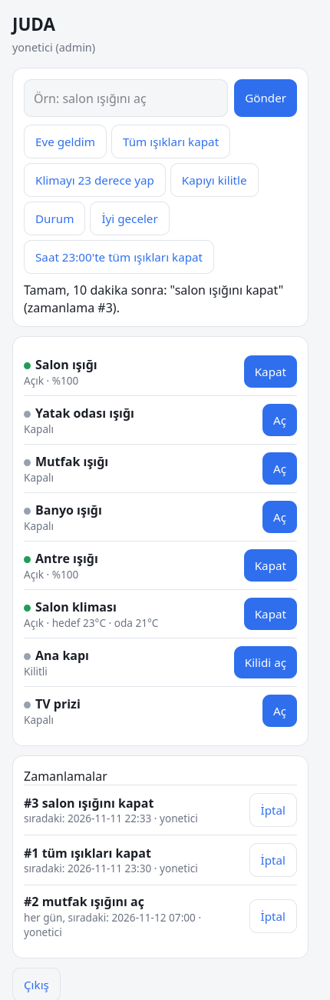
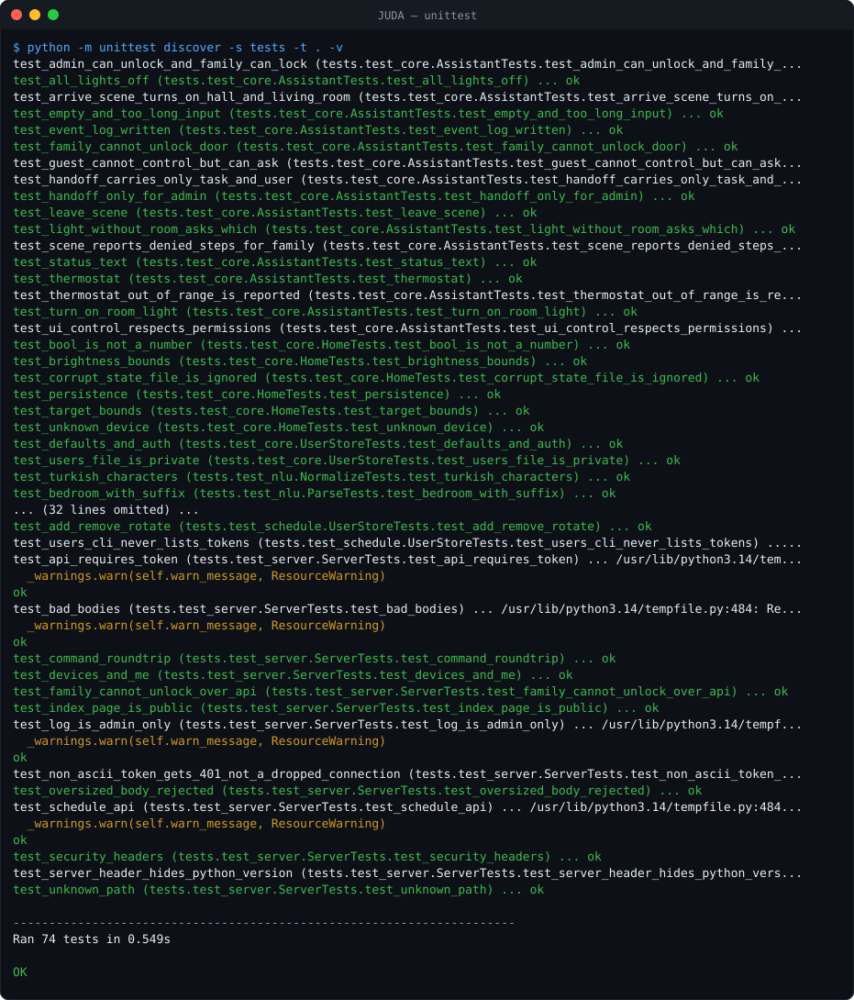
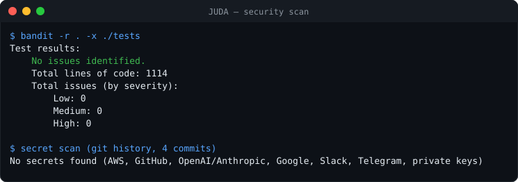

# JUDA

[](https://github.com/fas0ftware/JUDA/actions/workflows/ci.yml)


-brightgreen)




A smart home digital assistant for controlling home technologies from your phone. This version is a **proof of concept / prototype**: devices are simulated, commands are typed in Turkish, and the UI runs in a phone browser. It uses only the Python standard library (nothing to install).

## Running

```bash
python3 -m juda                      # http://127.0.0.1:8765
python3 -m juda --host 0.0.0.0       # to reach it from a phone on the same network
python3 -m juda --port 9000 --data-dir /path/to/data
```

On first run, `data/users.json` is created and an access token for each user is printed to the console **once**. Log in to the UI with one of these tokens. Later starts only list user names; tokens are never printed again unless you rotate them. The `data/` folder is listed in `.gitignore`; do not share the tokens.

### Users

```bash
python3 -m juda users list                 # names and roles (never tokens)
python3 -m juda users add cocuk guest      # new user, prints its token once
python3 -m juda users rotate aile          # new token, the old one stops working at once
python3 -m juda users remove cocuk         # the last admin cannot be removed
```

If you use `--host 0.0.0.0`, the server is open to everyone on your local network and traffic is unencrypted (plain HTTP). Only use it on a network you trust.

## What it can do

The assistant understands Turkish commands:

| Example command | Effect |
|---|---|
| `salon ışığını aç` / `mutfağı kapat` | turn a room's light on/off |
| `tüm ışıkları kapat` | all lights |
| `yatak odası ışığını %40 yap` | set brightness |
| `klimayı 23 derece yap`, `evi ısıt`, `salonu soğut` | air conditioner (10–30 °C) |
| `kapıyı kilitle` / `kapıyı aç` | door lock / unlock |
| `kapı kilitli mi?`, `durum` | status queries |
| `eve geldim`, `çıkıyorum`, `iyi geceler` | scenes (arrive, leave, night) |
| `bana şu script için kod yaz` | unrecognized or heavy task → handed off to Daedalus |
| `saat 22:30'da tüm ışıkları kapat` | **schedule** a command for 22:30 (today, or tomorrow if the time has passed) |
| `10 dakika sonra mutfağı kapat`, `2 saat sonra iyi geceler` | schedule relative to now (1 minute to 7 days) |
| `her gün 07:00'de salon ışığını aç` | daily schedule |
| `zamanlamalar`, `zamanlama 2 iptal`, `tüm zamanlamaları iptal et` | list / cancel schedules |

### Scheduling

Only device commands and scenes can be scheduled. Permissions are checked twice: when the schedule is created and again when it runs, with the user's role **at that moment**. If a user is demoted or removed in the meantime, their pending jobs no longer act with the old rights. Schedules survive restarts (`data/schedules.json`); a daily job that was missed during downtime runs once, not once per missed day. Family and guest users see and cancel only their own schedules; the admin sees all of them.

## Roles

- **admin**: can do everything; can view the event log and Daedalus tasks.
- **family**: everyday device control; **cannot** unlock the door and cannot send tasks to Daedalus.
- **guest**: can only ask for status.

## Relationship with Daedalus

JUDA handles simple home tasks and hands hard tasks over to Daedalus. The two systems do not share context or memory: a handoff carries only the task text and the name of the requesting user. For now Daedalus is a stub (`juda/router.py`) that writes tasks to `data/handoffs.jsonl`. A real integration only needs a class that implements the `DaedalusClient` interface (`submit`, `list_tasks`).

## Project layout

```
juda/devices.py   simulated devices + state machine + persistence (data/state.json)
juda/nlu.py       rule-based Turkish command parser
juda/users.py     roles, permissions, token authentication
juda/core.py      command -> intent -> permission check -> devices; scenes; event log
juda/router.py    handoff to Daedalus (stub)
juda/schedule.py  time expressions, persistent scheduler thread
juda/server.py    HTTP API + UI server (stdlib only)
juda/static/      phone-friendly web UI
tests/            unit and server tests
```

API: `GET /api/me`, `GET /api/devices`, `POST /api/command {"text": "..."}`, `POST /api/device {"id", "action", "value"}`, `GET /api/schedules`, `DELETE /api/schedules/<id>`, `GET /api/log` (admin), `GET /api/handoffs` (admin). All endpoints require an `Authorization: Bearer <token>` header.

## Security notes

- Tokens are random (192 bit), compared in constant time, and stored in `data/users.json` with file mode `0600`. A malformed token, including one with non-ASCII characters, simply gets `401`.
- Request bodies are limited to 64 KB.
- Every response carries `X-Content-Type-Options`, `X-Frame-Options` and `Referrer-Policy`; the UI page also carries a `Content-Security-Policy` that only allows the page's own script and requests to the same server.
- The `Server` header does not reveal the Python version; tokens are printed only on creation or rotation.
- User text is always rendered with `textContent` in the UI, never as HTML.
- Traffic is plain HTTP; see the warning above about `--host 0.0.0.0` (the server also prints a warning).

## Tests

```bash
python3 -m unittest discover -s tests -t .
```

74 tests: the Turkish parser, permissions, scenes, the HTTP API (auth, limits, headers), time expressions, the scheduler (persistence, missed daily jobs, corrupt files, limits), permission re-checks at run time, and user management. GitHub Actions runs them on Python 3.10–3.13, plus bandit.





## Known limitations / next steps

- Devices are simulated; there is no real integration yet (MQTT, Zigbee, Tuya, Home Assistant, etc.).
- The parser is rule-based: it understands known patterns, and free-form sentences fall through to Daedalus. Commands are Turkish only.
- User management is a command-line tool; there is no user admin page in the UI.
- It runs over plain HTTP; access from outside the home would require TLS and a reverse proxy.

## Changelog

- **0.2.0** – Scheduling (clock time, relative, daily; list/cancel by voice, API and UI), permission re-check when jobs run, `users` command (add/list/remove/rotate), tokens printed only once, Python version hidden from the `Server` header, schedules panel in the UI, more tests, CI with bandit.
- **0.1.0** – Turkish commands for simulated lights, AC, lock and plug; scenes; roles; token auth; phone UI; Daedalus handoff stub.

## License

[MIT](LICENSE)
